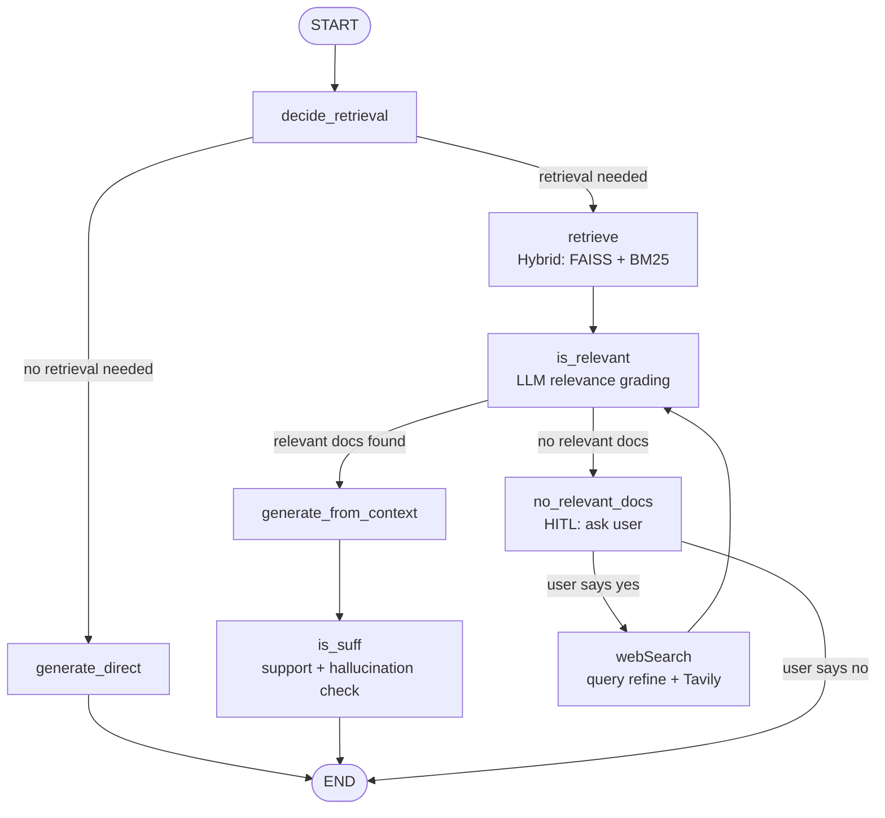

# 🧠 Advanced Self-RAG System

An advanced **Self-Reflective Retrieval-Augmented Generation (Self-RAG)** pipeline built with **LangGraph** and **LangChain**. Instead of blindly retrieving documents for every question, the system *decides* whether retrieval is needed, *judges* the relevance of what it retrieves, *verifies* that its answer is grounded in the context, and can fall back to a **human-approved web search** when the knowledge base has nothing useful.

---

## ✨ Features

- **Adaptive retrieval decision** – an LLM decides whether a question needs external documents or can be answered directly.
- **Hybrid retrieval** – combines semantic search (FAISS + sentence-transformer embeddings) with keyword search (BM25) using an ensemble retriever.
- **Document relevance grading** – each retrieved chunk is judged by the LLM and irrelevant chunks are filtered out.
- **Grounded answer generation** – answers are generated *only* from the relevant context.
- **Self-verification (hallucination check)** – the generated answer is evaluated as `fully_supported`, `partially_supported`, or `no_supported`, along with an `is_hallucinating` flag.
- **Query refinement + web search fallback** – if no relevant documents are found, the query is rewritten and searched on the web via Tavily.
- **Human-in-the-Loop (HITL)** – before any web search, the graph pauses and asks the user for approval (`yes` / `no`).
- **Stateful execution** – uses LangGraph's `MemorySaver` checkpointer so the graph can be interrupted and resumed.

---

## 🏗️ Architecture



### Node overview

| Node | Purpose |
|------|---------|
| `decide_retrieval` | Structured-output LLM call that returns `True`/`False` on whether external knowledge is needed (defaults to `True` when unsure). |
| `generate_direct` | Answers from the model's own knowledge when no retrieval is needed. |
| `retrieve` | Fetches chunks using the hybrid (vector + BM25) ensemble retriever. |
| `is_relevant` | Grades each retrieved document for relevance and keeps only the useful ones. |
| `generate_from_context` | Produces an answer using **only** the relevant context. |
| `is_suff` | Evaluates whether the answer is supported by the context and flags hallucinations. |
| `no_relevant_docs` | Pauses the graph with `interrupt()` and asks the user whether to search the web. |
| `webSearch` | Refines the query with the LLM, then fetches the top 3 results from Tavily. |

---

## 🛠️ Tech Stack

| Component | Technology |
|-----------|------------|
| Orchestration | [LangGraph](https://github.com/langchain-ai/langgraph) |
| LLM framework | [LangChain](https://github.com/langchain-ai/langchain) |
| LLM | `openai/gpt-oss-20b` served through [Groq](https://groq.com/) (`ChatGroq`) |
| Embeddings | `sentence-transformers/all-MiniLM-L6-v2` (Hugging Face) |
| Vector store | [FAISS](https://github.com/facebookresearch/faiss) |
| Keyword retriever | BM25 |
| Web search | [Tavily](https://tavily.com/) |
| Structured outputs | Pydantic |
| Document loading | `PyPDFDirectoryLoader` |

---

## 📁 Project Structure

```
Advanced-Self-RAG-System/
├── Advanced RAG pipeline.ipynb   # Full step-by-step implementation
├── documents/                    # Place your PDF knowledge-base files here
├── .env                          # API keys (not committed)
└── README.md
```

> The notebook builds the pipeline incrementally, in six steps: retrieval decision → relevance grading → context generation → answer verification → web search → human-in-the-loop.

---

## 🚀 Getting Started

### 1. Clone the repository

```bash
git clone https://github.com/ajayn3300/Advanced-Self-RAG-System.git
cd Advanced-Self-RAG-System
```

### 2. Create a virtual environment

```bash
python -m venv venv
source venv/bin/activate      # On Windows: venv\Scripts\activate
```

### 3. Install dependencies

```bash
pip install python-dotenv pydantic pypdf faiss-cpu rank_bm25 sentence-transformers \
            langchain langchain-classic langchain-community langchain-core \
            langchain-groq langchain-huggingface langchain-tavily langgraph jupyter
```

### 4. Configure environment variables

Create a `.env` file in the project root:

```env
GROQ_API_KEY=your_groq_api_key
TAVILY_API_KEY=your_tavily_api_key
# Optional: only needed if you use Hugging Face Inference Endpoint embeddings
HF_TOKEN=your_huggingface_token
```

### 5. Add your documents

Put your PDF files inside the `documents/` folder. They will be loaded, split into chunks (`chunk_size=1000`, `chunk_overlap=100`), embedded, and indexed automatically.

### 6. Run the notebook

```bash
jupyter notebook "Advanced RAG pipeline.ipynb"
```

---

## 💡 Usage Example

```python
config = {"configurable": {"thread_id": "1"}}

# Ask a question
result = app.invoke(
    {"question": "Tell me about the financial performance of the company"},
    config=config
)

# If no relevant documents exist, the graph pauses and asks for permission
if result.get("__interrupt__"):
    print(result["__interrupt__"][-1].value)
    # -> "there is no relevant information about the query you asked.
    #     Do you want to search on web? - yes/no"

    # Resume the graph with the user's decision
    from langgraph.types import Command
    result = app.invoke(Command(resume="yes"), config=config)

print(result["answer"])
print("Support level:   ", result.get("is_supporting"))
print("Hallucinating?:  ", result.get("is_hallucinating"))
```

---

## 🔄 How It Works

1. **Decide** – The LLM classifies whether the question needs external facts or can be answered from general knowledge.
2. **Retrieve** – If needed, a hybrid retriever (40% semantic, 60% keyword weighting) pulls the top chunks from the document store.
3. **Grade** – Every chunk is checked for relevance; only useful ones move forward.
4. **Generate** – The answer is written strictly from the relevant context.
5. **Verify** – A supervisor LLM labels the answer as fully, partially, or not supported and flags hallucinations.
6. **Fallback** – If nothing relevant is found, the user is asked for permission to search the web. On approval, the query is refined, Tavily results are fetched, and they are re-graded before generating the final answer.

---

## 🔮 Future Improvements

- Retry / rewrite loop when an answer is `partially_supported` or hallucinated
- Support for more document types (DOCX, TXT, web pages)
- Persistent vector store instead of in-memory FAISS
- Web UI using Streamlit or Gradio
- Evaluation with RAGAS or similar metrics
- Source citations in the final answer

---

## 🤝 Contributing

Contributions, issues, and feature requests are welcome. Feel free to open an issue or submit a pull request.

---

## 👤 Author

**Ajay** – [@ajayn3300](https://github.com/ajayn3300)

If you found this project useful, consider giving it a ⭐!
